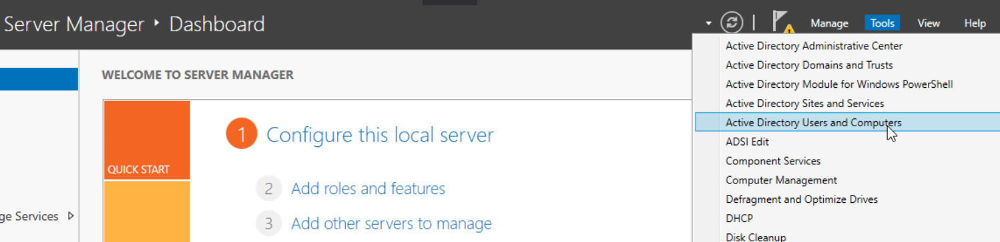
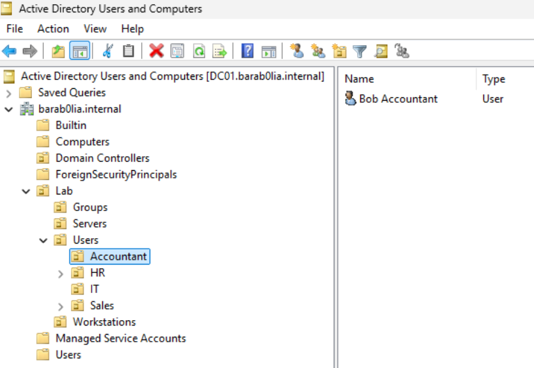
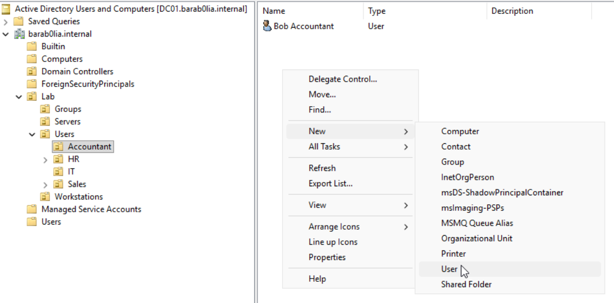
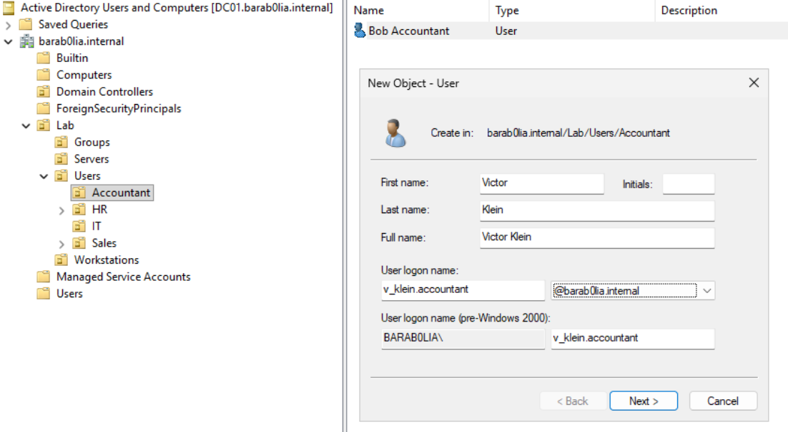
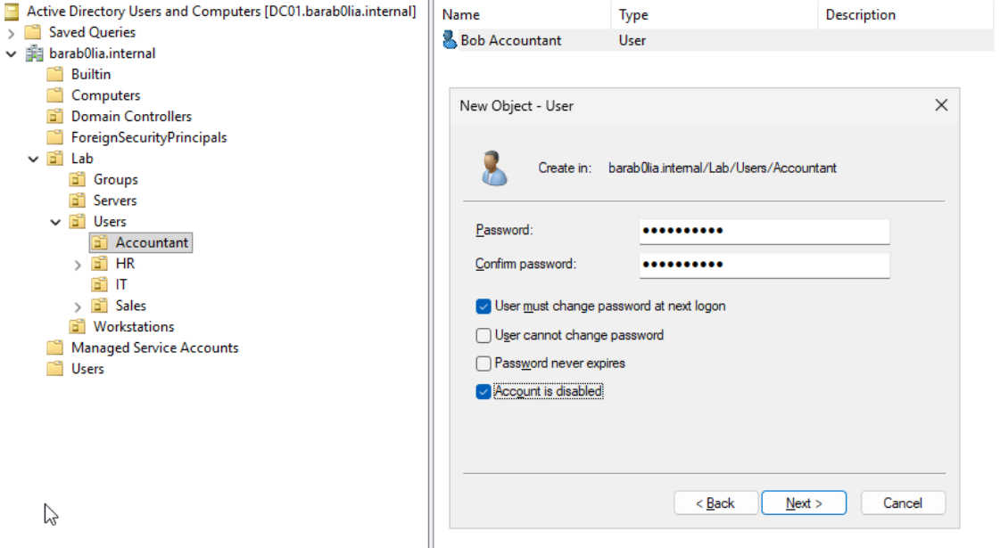
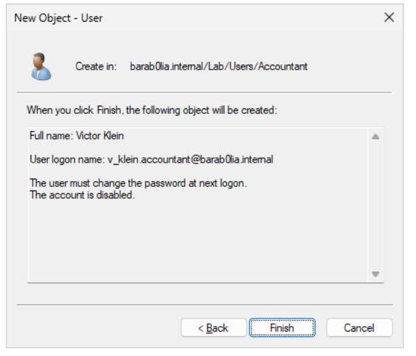
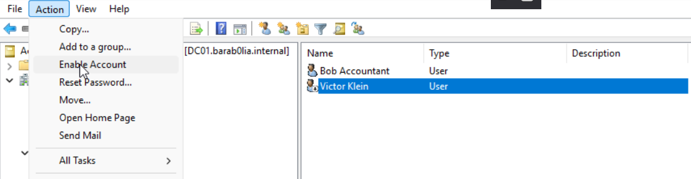

To create the Active Directory user navigate to Active Directory Users and Computers Console. You can find it just searching in search bar or using Server Manager console and spot it under `Tools` tab

Now make sure that you create in the right location. Because if you created the AD user in the wrong place they could get the wrong GPO security settings applied to them. It may violate the principle of least privilege and other security policies in your organizations, expand a surface for attacker. So just keep this in mind while you are doing this and double-check it.

Commonly in organizations there will be main OU under which all other necessary OUs will be created.

This is our structure. For example organization hire a new person in accountant department. Our task is to create an account for that user in the correct place. To do so, navigate to the correct OU, Accountant in our case, and right click anywhere in the right part to open dialog window.

Then fill the fields. Make sure that the user logon name is aligned with organizational convention of how to named a logon user.

Then you will be asked to provide a password for the user. This a best practice to tick the checkbox that user must change password at next logon because usually administrators during the user creation process just type the same password all the time. And without changing it all created user in organizations will have the same password that is a huge security violation and dramatically simplifies life for adversaries if they are in your network/system. Having guessed or revealed one password give them ability to log in to every account that was created. 
The next two options also lead to security vulnerabilities if you tick them

The last option `Account is disable` is  useful for situations when the new employee hasn't started their job yet. 

At the end you get the summary of what will be created. It is a good practice to double-check every information at this stage

Having finished the creation, new account will appear in the specified OU. Right now account Victor Klein has a little arrow on it that indicates that this account is disabled. To enable it, press the user and go to actions tab where you will see the same info if you just right click on a user. Then `Enable Account`.

